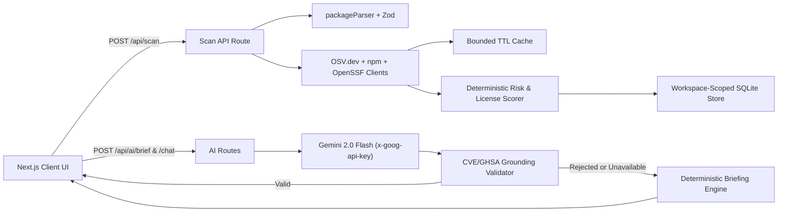

# VeriStack — Software Supply-Chain Intelligence & Upgrade Advisor

> **Real vulnerability, license & maintenance intelligence for modern dependencies.**
>
> VeriStack evaluates declared `package.json` manifests against live OSV.dev advisories, npm Registry manifests, and OpenSSF Scorecards, combining deterministic compliance scoring with grounded Google Gemini 2.0 Flash remediation briefings.

## Problem Statement

Modern JavaScript and TypeScript teams depend on dozens of third-party npm packages, yet standard CLI audits often dump noisy CVE lists without answering the questions engineers actually face:

1. Are any direct dependencies flagged by active **OSV / CVE / GHSA** advisories or npm deprecation notices?
2. Does a dependency's **SPDX license** conflict with commercial SaaS compliance policies?
3. What is the **minimum target version** required to remediate risk, and does that bump cross a **breaking major semver boundary**?
4. How does upstream repository security hygiene (**OpenSSF Scorecard**) look?

## Solution & Key Innovations

VeriStack separates **deterministic policy math** from **natural-language explanation**:

1. **Multi-Source Live Telemetry (`src/lib/providers/`)**:
   - **OSV.dev Batch API (`POST /v1/querybatch` + `GET /v1/vulns/<id>`)**: Queries verified CVE/GHSA advisories and fixed-version events.
   - **npm Public Registry (`/<package>/latest`)**: Inspects SPDX licenses, deprecation banners, latest semver releases, and repository slugs.
   - **OpenSSF Security Scorecards**: Resolves GitHub repository security hygiene scores cleanly with graceful `NOT_INDEXED` handling.
2. **Deterministic Policy & Upgrade Engine (`src/lib/engine/`)**:
   - Parses `package.json` manifests via Zod (`dependencies` & `devDependencies`).
   - Classifies upgrade impact (`NONE`, `PATCH`, `MINOR`, `MAJOR`) and selects verified fixed releases.
   - Evaluates compound SPDX expressions (`(MIT OR GPL-3.0)`) deterministically against compliance rules.
3. **Grounded Generative AI (`src/lib/ai/`)**:
   - Uses **Google Gemini 2.0 Flash** strictly server-side (`x-goog-api-key` header) to summarize scan outputs for three personas (**Engineering Lead**, **Security Auditor**, **Developer**) and answer grounded Q&A.
   - Output validator (`validateAiTextAgainstReport`) rejects any LLM response containing fabricated CVE/GHSA IDs not present in the scan payload, falling back to deterministic playbooks seamlessly.
4. **Workspace-Isolated Persistence (`src/lib/db/`, `src/lib/security/`)**:
   - Cryptographically signed (`HMAC-SHA256`), `HttpOnly` workspace cookies (`veristack_ws`) isolate custom compliance policies and saved SQLite audit records across sessions.

## Features

- Live `package.json` paste/upload scanner plus realistic preset stacks.
- Configurable built-in compliance presets (_Commercial SaaS Strict_, _Balanced Engineering_, _Open-Source Maintainer_) and custom workspace policies.
- Interactive portfolio health gauge, summary KPI cards, filterable Dependency Risk Ledger, and per-package drill-down modal.
- Audience-adaptive AI remediation brief with `npm install` upgrade commands.
- Grounded conversational Q&A assistant citing verified packages and advisories.
- Markdown and JSON audit report exports.
- WCAG 2.2 AA accessible interface (verified via Axe-Core in Playwright).

## Technology Stack

| Layer                       | Technology                                                                                 |
| --------------------------- | ------------------------------------------------------------------------------------------ |
| Framework                   | Next.js 16 (App Router)                                                                    |
| UI & Styling                | React 19, Tailwind CSS v4                                                                  |
| Language & Validation       | TypeScript (strict + `noUncheckedIndexedAccess`), Zod                                      |
| Persistence                 | Parameterized `node:sqlite` (with atomic JSON fallback for runtimes without `node:sqlite`) |
| Generative AI               | Google Gemini 2.0 Flash (server-side REST with deterministic fallback)                     |
| Unit & API Testing          | Vitest                                                                                     |
| E2E & Accessibility Testing | Playwright + `@axe-core/playwright`                                                        |
| Formatting & Linting        | Prettier, ESLint (`eslint-config-next`, `--max-warnings 0`)                                |

## System Architecture



See [ARCHITECTURE.md](ARCHITECTURE.md) and [docs/API_REFERENCE.md](docs/API_REFERENCE.md) for module responsibilities and API contracts.

## Local Setup & Environment Configuration

### Prerequisites

- Node.js 22.5+ (tested on Node 24.18) and npm.

### Installation

```bash
git clone <repository-url> veristack
cd veristack
npm install
cp .env.example .env.local
```

Configure `.env.local` (optional Gemini key; without it, deterministic fallback mode runs cleanly):

```env
GEMINI_API_KEY=your_gemini_api_key_here
SESSION_SECRET=replace_with_random_32_byte_hex_secret
```

### Run Locally

```bash
npm run dev
```

Open `http://localhost:3000`.

### Quality Gates & Tests

```bash
npm run qa          # Prettier check + ESLint (0 warnings) + tsc --noEmit + Vitest suite
npm run build       # Production Next.js build
npm run test:e2e    # Playwright desktop + mobile Chromium workflows & Axe WCAG 2.2 AA audit
```

See [TESTING.md](TESTING.md) for detailed test architecture and latest observed results.

## Deployment (Vercel-Compatible)

1. Push repository to GitHub and import into Vercel.
2. Set `SESSION_SECRET` (random 32-byte hex string) and optionally `GEMINI_API_KEY` as server-side Environment Variables.
3. Build command: `npm run build`.
4. Verify `/api/health` returns `{ "status": "ok" }` cleanly after deployment.

## Known Limitations

- Evaluates declared direct `dependencies` and `devDependencies` in `package.json`; full lockfile (`package-lock.json`) transitive graph resolution is scoped for a future milestone.
- Semver ranges (`^` / `~`) are evaluated at their declared baseline floor rather than resolving lockfile exact resolved trees.
- OpenSSF Scorecard telemetry is available only for packages with public GitHub repository URLs indexed by OpenSSF.
- On ephemeral serverless filesystems (e.g., `/tmp` on Vercel), saved workspace policies and audits persist per warm container lifecycle unless paired with a managed remote SQL database.

## Future Roadmap

- `package-lock.json` / `pnpm-lock.yaml` transitive dependency graph tree auditing.
- GitHub PR comment webhook / SARIF CI export integration.
- Optional remote LibSQL / Neon Postgres backend adapter for cross-region team workspaces.

## License

Licensed under the MIT License. See [LICENSE](LICENSE).
